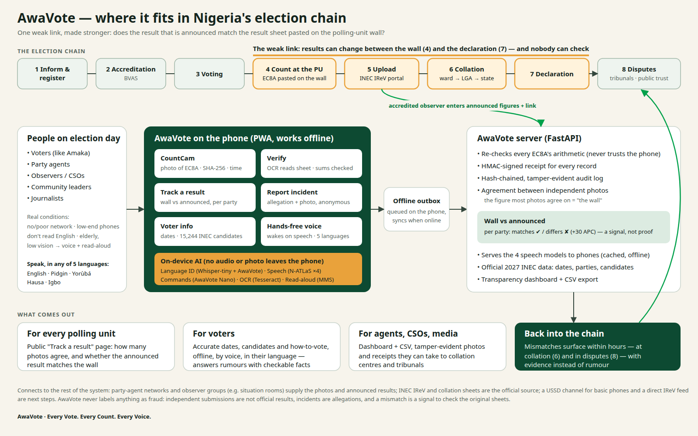

# AwaVote

**Every Vote. Every Count. Every Voice.**

AwaVote is an offline-first, multilingual election-transparency app for Nigeria. "Awa" is Nigerian
Pidgin for "our". It turns the photos people already take of result sheets into checkable public
evidence, and it speaks the voter's language, hands-free.

| | |
|---|---|
| **Live app** | **https://zakumi-awavote.static.hf.space** (also listed at https://huggingface.co/spaces/zakumi/awavote) |
| **Live API** | https://awavote-api.onrender.com 

**Demo Video** - 

### System sketch


---

## 1. The problem: the weak link we chose
At about 176,000 polling units, the presiding officer fills in the result sheet (**EC8A**), pastes a
copy on the wall, and uploads a photo to INEC's Result Viewing portal (**IReV**). The results are
then added up at ward, LGA and state level and declared.

People photograph the wall, but those photos stay in private chats. They can't be shown to be
unedited, and nobody can compare them with what was announced. So **nobody can say, polling unit by
polling unit, whether what the community saw is what was counted.** Rumours fill the gap, and trust
in the whole result suffers.

**Who it affects:**
- **Voters**, about 93.5 million registered in 2023, who can't tell whether their community's votes
  survived collation.
- **Party agents and observers**, whose photos prove nothing on their own.
- **Community leaders, journalists and CSOs**, who need checkable facts quickly, in local languages
  and often offline.
- **INEC and the courts**, who face disputes built on unverifiable claims.

## 2. The solution
### Core feature: track a result from the wall to the announcement
1. **Scan result sheet.** Photograph the EC8A on the wall. The photo is fingerprinted (SHA-256) and
   time-stamped on the phone, even offline, so any later edit is detectable.
2. **Verify.** On-device OCR reads the sheet, and AwaVote checks the EC8A arithmetic. A problem is
   labelled *needs review*, never "fraud".
3. **Sync.** Records wait in an offline outbox and upload when there is signal. The server re-checks
   everything, issues an **HMAC-signed receipt** and writes a **hash-chained, tamper-evident audit
   log**.
4. **Agreement.** Independent photos of the same polling unit are compared. The figure most of them
   agree on is "the wall".
5. **Wall vs announced.** Accredited observers enter the officially announced result (IReV image,
   collation sheet or announcement), with its link and their observer key. **Track a result**
   shows, party by party, ✔ *matches* or ✘ *differs (+30 APC)*. The transparency dashboard and its
   CSV export make this visible to everyone.

### Built for real Nigerian conditions
- **Poor or no network:** works fully offline. See [How offline works](#3-how-offline-works).
- **Voters who don't read English:**
  - **Hands-free voice.** The microphone wakes when you speak, with no button. AwaVote **detects the
    language you speak** (English, Pidgin, Yorùbá, Hausa, Igbo), switches to it and acts. For
    example, "fi àwọn olùdíje hàn mí" opens the candidates, in Yorùbá.
  - Read-aloud.
  - A translated interface.
- **Elderly voters and voters with low vision:** four text sizes, high contrast, dark mode, reduced
  motion, and voice instead of typing.
- **Accurate information against misinformation:** official 2027 dates (with a live countdown), all
  22 registered parties with their INEC logos, and **15,244 candidates** from INEC's published lists,
  each traceable to its INEC PDF, with verified, freely licensed photos.
- **Incident reports:** anonymous, stored as *allegations* until reviewed.
- **Privacy:** speech, photos and OCR are processed on the phone. Audio never leaves the device.

> AwaVote never presents its data as official results. Submissions are *independent*. Incident
> reports are *allegations* until reviewers check them. A mismatch is a signal to check the original
> sheets, not proof of wrongdoing.

## 3. How offline works
AwaVote is a **Progressive Web App**. No app store is needed: it runs in any phone browser and can be
installed with **Add to Home screen**.

1. **First visit, with internet:**
   - A service worker saves every page, the INEC election data (dates, parties, candidates, logos,
     photos) and the on-device AI on the phone: the command model, the language detector, OCR, and the
     speech model for your language.
   - The other languages' speech models download by themselves in the background on Wi-Fi, about 290
     MB each.
2. **Afterwards, with no network:**
   - the app opens and every page works;
   - voice commands are understood on the phone;
   - result-sheet photos and incident reports are saved in an **outbox** on the phone.
3. **When the signal returns:** the outbox uploads by itself, and each record gets a signed receipt.
   Only *Track a result* (comparing with what other people sent) needs a connection.

## 4. Try the live demo
1. Open **https://zakumi-awavote.static.hf.space** on a phone (Chrome or Safari), or on a desktop
   browser. The free API host sleeps when unused, so the first *Track a result* can take about a
   minute.
2. **Track a result:** enter `DEMO-001`, where the announced result matches the wall, then
   `DEMO-002`, where it differs (APC +30). Both are clearly labelled demo data.
3. **Hands-free voice:** tap **Turn on** once and allow the microphone. Then say "find my polling
   unit", or in Yorùbá "fi àwọn olùdíje hàn mí". AwaVote switches language by itself.
4. **Offline:** after the first visit, turn on airplane mode. The app keeps working, voice included.
5. **Scan result sheet → Verify:** photograph an EC8A (or a printout), tap *Read figures from photo*,
   and see the checks.

## 5. How AI is used (on the phone, offline)
| Job | Model | Notes |
|---|---|---|
| Which language is being spoken? | Whisper-tiny (OpenAI) + **our language-ID head** (`ai/language_id/`) | Trained on FLEURS, Nigerian-accented English and Nigerian Pidgin speech. 90% on held-out clips; 10/10 on real Nigerian speakers |
| Speech → text | **N-ATLaS** (Awarri / Federal Government of Nigeria): Yoruba, Hausa, Igbo, Nigerian English | Converted to int8 ONNX (291 MB each), with a short-window encoder that is about 4× faster. Runs in a Web Worker (`ai/speech_to_text/`) |
| Understanding commands | **AwaVote Nano** (ours, 370 KB ONNX) | 18 commands in 5 languages, trained on our phrasings and on what the speech models transcribe (`ai/intent/`) |
| Reading result sheets | Tesseract (Tesseract.js) | Pre-fills the form. People confirm every number |
| Read-aloud | Meta MMS-TTS (Yoruba) + the phone's own voices | |
| Translating the interface | Meta NLLB-200 (Yorùbá, Hausa, Igbo), NITHUB-AI English→Pidgin | Run at build time behind automatic quality checks (`ai/translation/`). English where a translation fails the checks |

**Hands-free mode:**
1. Voice-activity detection cuts out each phrase.
2. The language detector picks the language.
3. That language's model transcribes the phrase.
4. The command model decides what it means.
5. AwaVote acts only on clear commands and ignores background talk.

## 6. Architecture
```
client/   Next.js 16 static-export PWA (React 19, Tailwind 4): service worker, IndexedDB outbox,
          ONNX Runtime Web + Transformers.js (speech in a Web Worker: public/asr-worker.js), Tesseract.js
server/   FastAPI + SQLAlchemy + Alembic (SQLite): results, official results, evidence, incidents,
          signed receipts, hash-chained audit log, election data, speech-model hosting (/asr-models)
ai/       model conversion (N-ATLaS → int8 ONNX), language-ID training, command-model training,
          interface translation, model cards and evaluation reports
deploy/   deployment scripts (demo data seeding, model upload) and an optional Dockerfile
```
Main API endpoints:
- `POST /api/results`: an independent EC8A submission;
- `POST /api/official-results`: an announced result, observers only, with the `X-Observer-Key` header;
- `GET /api/results/compare/{pu}`: wall vs announced;
- `POST /api/evidence` and `POST /api/incidents`;
- `GET /api/dashboard/summary`;
- `GET /api/audit/verify`;
- `GET /api/speech/models`.

Interactive API docs are served at `/docs`.

## 7. Run it locally
```bash
# API (http://localhost:8000, docs at /docs)
cd server
python3 -m venv .venv && .venv/bin/pip install -r requirements.txt
.venv/bin/alembic upgrade head
AWAVOTE_OBSERVER_KEY=dev-observer-key .venv/bin/uvicorn main:app --reload

# App (http://localhost:3000)
cd client
npm install
npm run dev                      # development
npm run build && npm start       # production build with the service worker (offline mode)
```
- **Speech models** (optional locally): `ai/speech_to_text/convert_natlas.py` converts the N-ATLaS
  models into `server/data/models/`. It needs a Hugging Face account that has accepted Awarri's terms.
- **Same-origin mode**, as in production: build the client with `NEXT_PUBLIC_API_URL=/`, then start
  the API with `AWAVOTE_STATIC_DIR=../client/out`.
- **Secure context:** the camera and microphone need one. `localhost` counts.

## 8. Tests
```bash
cd server && .venv/bin/python -m pytest   # 33 tests: API, idempotency, integrity, audit chain, wall vs announced, observer key
cd client && npm test                     # 40 tests: validation, featuriser parity, image pipeline, OCR parser, router, sync
```
An automated end-to-end test in real Chrome ran against the deployed configuration and passed
**36/37** checks:
- spoken commands in English, Yorùbá, Hausa and Pidgin, with automatic language switching;
- wall vs announced, and observer entry;
- camera capture and incident upload;
- every page;
- offline mode, including a voice command.

The one failure is an Igbo command spoken by a synthetic test voice, which the language detector
hears as Yorùbá. Nothing happens in that case.

## 9. Deployment
Two free, public HTTPS services:

| Part | Host | Address |
|---|---|---|
| App + on-device AI models | Hugging Face **static Space** `zakumi/awavote` | https://zakumi-awavote.static.hf.space |
| API (FastAPI) | **Render** free web service `awavote-api` | https://awavote-api.onrender.com |

**Why it still works offline:** the app is static files. On the first visit the service worker
stores the pages, the INEC data and the AI models on the phone, so the app no longer needs either
host. Only uploading records and *Track a result* use the API; uploads wait in the phone's outbox
until there is signal. No server, wherever it is hosted, can be reached without internet, so this
is the part that makes AwaVote work offline.

**App (static Space):**
1. Build the client pointed at the API and at the Space's model folder:
   `NEXT_PUBLIC_API_URL=https://awavote-api.onrender.com NEXT_PUBLIC_MODELS_URL=/asr-models npm run build`.
2. Upload `client/out/` plus the speech models (as `asr-models/`) to the Space. Its `README.md`
   front matter sets `sdk: static` and `custom_headers` (`cross-origin-embedder-policy:
   require-corp`, `cross-origin-opener-policy: same-origin`, `cross-origin-resource-policy:
   cross-origin`) so speech recognition can run multi-threaded.

**API (Render):** root directory `server`, Python 3.12.
- Build: `pip install -r requirements.txt`
- Start: `alembic upgrade head && python ../deploy/seed_demo.py && uvicorn main:app --host 0.0.0.0 --port $PORT --proxy-headers --forwarded-allow-ips '*'`
- Environment: `AWAVOTE_CORS_ORIGINS=["https://zakumi-awavote.static.hf.space"]`,
  `AWAVOTE_ENVIRONMENT=production`, and secrets `AWAVOTE_RECEIPT_SECRET` and
  `AWAVOTE_OBSERVER_KEY` (random values; the observer key is given only to accredited observers).
- The free plan's disk is temporary, so the demo database is re-created and re-seeded
  (`DEMO-001`, `DEMO-002`) on every restart.

**One server instead (any host with Python or Docker):** build the client with
`NEXT_PUBLIC_API_URL=/` and start the API with `AWAVOTE_STATIC_DIR=../client/out`. It then serves
the app, the API and the models (`/asr-models`) from one address and adds the cross-origin
isolation headers itself. `deploy/Dockerfile` packages this (Hugging Face Docker and Gradio Spaces
now need a paid plan, so the live demo uses the two free hosts above).

## 10. Credits
AwaVote was built during the hackathon. It stands on these open-source libraries, pre-trained
models, public datasets and public data.

### Pre-trained AI models
| Model | By | Licence | Used for |
|---|---|---|---|
| N-ATLaS Yoruba-ASR, Hausa-ASR, Igbo-ASR, NigerianAccentedEnglish (Whisper-small fine-tunes) | Awarri Technologies with the Federal Government of Nigeria (NCAIR1 on Hugging Face) | N-ATLaS Open-Source Research and Innovation License | On-device speech recognition. Converted to int8 ONNX and named "… Powered by Awarri", as the licence requires |
| whisper-tiny (`onnx-community/whisper-tiny`) | OpenAI | MIT | Base for our spoken-language detector; fallback speech recognition |
| MMS-TTS Yoruba (`Xenova/mms-tts-yor`) | Meta | CC-BY-NC 4.0 | Offline read-aloud in Yorùbá |
| NLLB-200 distilled 600M (`facebook/nllb-200-distilled-600M`, CTranslate2 int8 build by JustFrederik) | Meta | CC-BY-NC 4.0 | Translating the interface into Yorùbá, Hausa and Igbo (offline, at build time) |
| `NITHUB-AI/marian-mt-bbc-en-pcm` | NITHUB-AI (University of Lagos) | CC-BY 4.0 | Translating the interface into Nigerian Pidgin |
| Tesseract LSTM English (`@tesseract.js-data/eng`) | Tesseract OCR | Apache 2.0 | Reading EC8A result sheets on the phone |
| MMS-TTS English, Hausa; `waxal-benchmarking/mms-tts-ibo-rnjema101` | Meta / WAXAL | CC-BY-NC 4.0 | Testing only: synthetic voices for automated voice tests |

Models we built: **AwaVote Nano** (command classifier) and **AwaVote language ID** (spoken-language
classifier on top of Whisper-tiny).

### Datasets
| Dataset | Licence | Used for |
|---|---|---|
| Google FLEURS (`en_us`, `yo_ng`, `ha_ng`, `ig_ng`) | CC-BY 4.0 | Training and testing the language detector |
| `benjaminogbonna/nigerian_accented_english_dataset` | Apache 2.0 | Language detector (Nigerian English) |
| `asr-nigerian-pidgin/nigerian-pidgin-1.0` | CC-BY 4.0 | Language detector (Nigerian Pidgin) |
| `Axiveri/NaijaVox-2.0` audio samples | Apache 2.0 | Evaluation only (real Nigerian speakers) |

### Public data
- **INEC:** 2027 election timetable, register of political parties and party logos, and final lists
  of nominated candidates (President, Governor, Senate, House of Representatives, State Houses of
  Assembly). Each record links to its INEC PDF.
- **Wikimedia Commons / Wikidata:** candidate photos (CC-BY, CC-BY-SA, CC0 or public domain),
  credited per photo in the app.

### Libraries and tools
Next.js, React, Tailwind CSS, ONNX Runtime Web, Transformers.js (Hugging Face), Tesseract.js, idb,
sharp, Vitest, ESLint. FastAPI, Uvicorn, SQLAlchemy, Alembic, Pydantic, httpx, pytest.
PyTorch, Hugging Face Transformers, Optimum, ONNX, ONNX Runtime, CTranslate2, SentencePiece,
soundfile, PyArrow. Hugging Face Spaces (static), Render.

### AI coding assistant
We used **Claude Code (Anthropic)** during the hackathon to help write and
test code, convert and benchmark models, and draft documentation. The team directed the work, made
the design decisions and reviewed the results.

